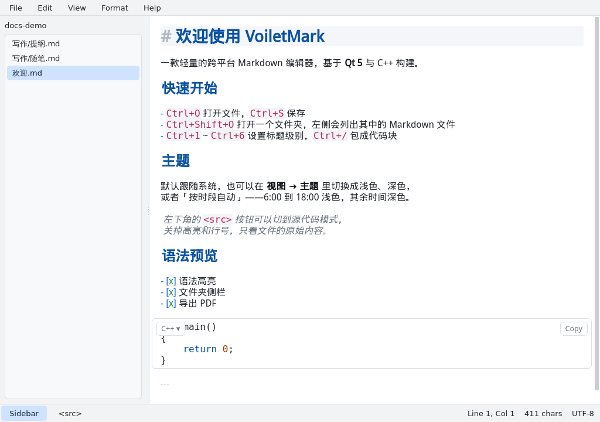
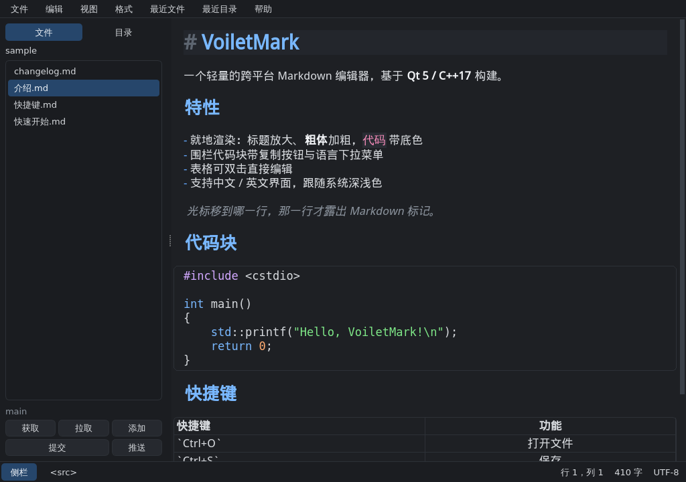

# VoiletMark

一个轻量的跨平台 Markdown 编辑器，基于 **Qt 5 / C++17** 构建。

当前版本 **0.1.0**：先把编辑器本体做扎实——干净的界面、顺手的编辑手感、
以及**自动跟随系统**的浅色 / 深色主题。

## 界面

| 浅色 | 深色 |
| --- | --- |
|  |  |

## 功能

### 编辑

- Markdown 语法高亮：标题、粗体 / 斜体 / 删除线、行内代码、围栏代码块、
  链接与图片、引用、有序 / 无序列表、任务列表、分隔线
- 行号栏、当前行高亮
- `Tab` / `Shift+Tab` 整行缩进，选中多行时批量缩进
- 自动换行（`Alt+Z`）、`Ctrl+滚轮` 或 `Ctrl++` / `Ctrl+-` 缩放字号
- 撤销 / 重做、剪切 / 复制 / 粘贴，菜单项会跟随可用状态自动灰显
- 把 Markdown 文件直接拖进窗口即可打开

### 文件

- 新建、打开、保存、另存为、最近打开（最多 8 条）
- 保留原文件的 **BOM** 与 **CRLF** 换行风格，保存时原子写入（`QSaveFile`）
- 关闭或切换文件时提示未保存的修改
- 记忆窗口位置、字号、换行开关等设置

### 主题

界面默认**跟随系统**自动在浅色 / 深色之间切换，每 2 秒检测一次：

| 平台 | 检测方式 |
| --- | --- |
| Windows | 注册表 `AppsUseLightTheme` |
| macOS | `defaults read -g AppleInterfaceStyle` |
| Linux | gsettings `color-scheme` / GTK 主题名 → KDE `kdeglobals` → XFCE `xsettings.xml` → 调色板兜底 |

也可以在 **视图 → 主题** 中手动锁定「跟随系统 / 浅色 / 深色」，选择会被记住。

## 构建

依赖：Qt 5.12+（含 Widgets 模块）、支持 C++17 的编译器。

### Qt Creator（推荐）

1. 用 Qt Creator 打开根目录的 `VoiletMark.pro`
2. 在 **项目 → 构建设置** 中选好本机的 Qt 5.15.2 套件（Kit）
3. `Ctrl+R` 直接运行

Qt Creator 默认走影子构建（shadow build），不会污染源码目录。

### 命令行

```bash
mkdir -p build && cd build
$HOME/Qt5/5.15.2/gcc_64/bin/qmake ../VoiletMark.pro
make -j"$(nproc)"
./VoiletMark
```

或者直接：

```bash
./scripts/build.sh
```

脚本会依次查找 `command -v qmake`、`$QT_PREFIX/bin/qmake`、
`$HOME/Qt5/5.15.2/gcc_64/bin/qmake`；也可以用 `QMAKE=/path/to/qmake` 直接指定。

## 命令行

```bash
VoiletMark                     # 打开编辑器（显示欢迎文档）
VoiletMark notes.md            # 直接打开指定文件
VoiletMark --theme dark        # 本次运行使用深色主题
VoiletMark --screenshot a.png  # 渲染窗口截图后退出（调试 / 视觉回归）
```

## 快捷键

| 快捷键 | 功能 |
| --- | --- |
| `Ctrl+N` / `Ctrl+O` / `Ctrl+S` | 新建 / 打开 / 保存 |
| `Ctrl+Shift+S` | 另存为 |
| `Ctrl+Z` / `Ctrl+Shift+Z` | 撤销 / 重做 |
| `Ctrl+滚轮`、`Ctrl++`、`Ctrl+-`、`Ctrl+0` | 缩放 / 恢复字号 |
| `Alt+Z` | 切换自动换行 |
| `Tab` / `Shift+Tab` | 缩进 / 反缩进 |
| `Ctrl+Q` | 退出 |

## 代码结构

```
src/
├── main.cpp               入口：命令行解析、Fusion 样式、主题初始化
├── ThemeManager.{h,cpp}   系统主题检测 + 调色板 / QSS 生成
├── MainWindow.{h,cpp}     菜单、文件读写、最近打开、状态栏、设置
├── MarkdownEditor.{h,cpp} 编辑器控件：行号、缩进、拖放、缩放
└── MarkdownHighlighter.{h,cpp}  Markdown 语法着色（含围栏代码块状态机）
```

## 下一版计划

- 实时预览（右侧或同屏渲染）
- 查找 / 替换
- 列表按回车自动续行
- 表格与数学公式支持
- 导出 HTML / PDF
