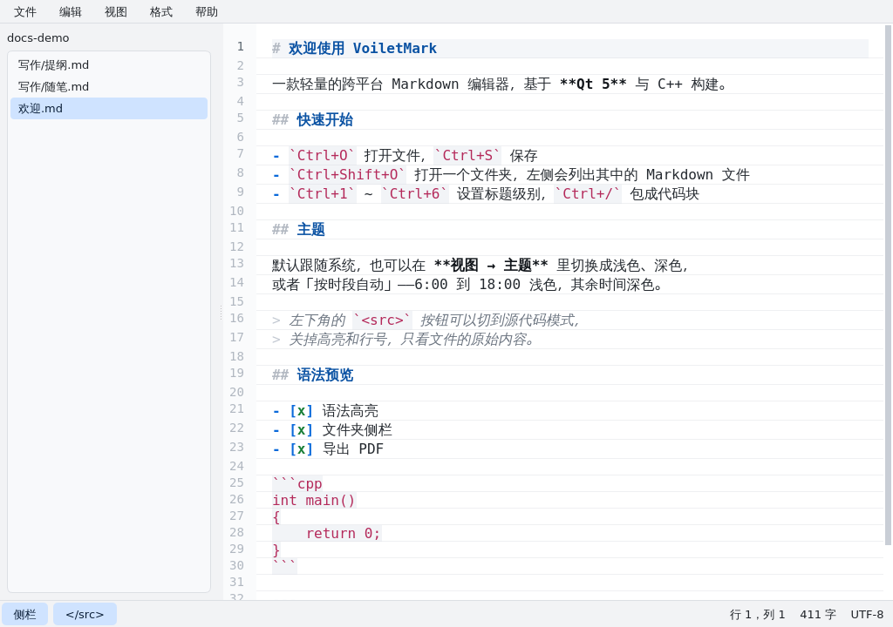
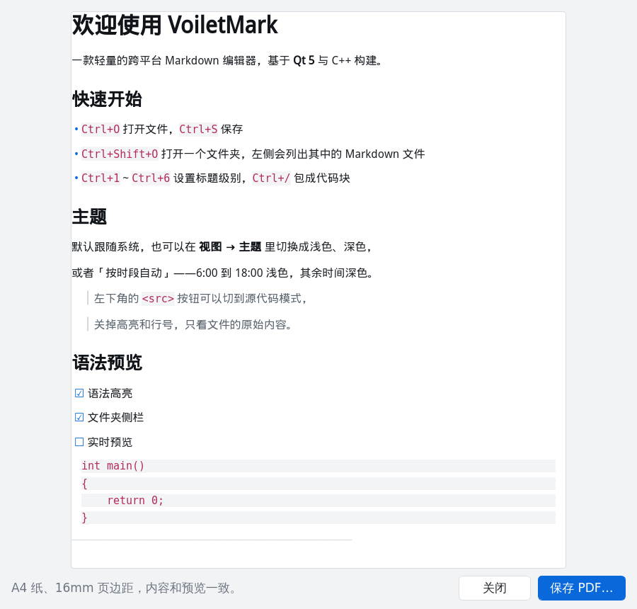

# VoiletMark

一个轻量的跨平台 Markdown 编辑器，基于 **Qt 5 / C++17** 构建。

当前版本 **0.5.0**。

## 界面

| 浅色 · 编辑模式 | 深色 · 编辑模式 |
| --- | --- |
|  |  |

源代码模式：等宽字体、行号、每行一条细线。



导出 PDF 前先给一个预览窗口，确认无误再选路径保存：



## 功能

### 编辑

- Markdown 语法高亮：标题、粗体 / 斜体 / 删除线、行内代码、围栏代码块、
  链接与图片、引用、有序 / 无序列表、任务列表、分隔线
- `Ctrl+1` ~ `Ctrl+6` 把选中行设成 1–6 级标题，再按一次变回正文
- `Ctrl+/` 把选中内容包成围栏代码块，再按一次拆掉
- 默认「编辑模式」隐藏 Markdown 标记、标题按级别放大，光标所在行露出原始标记
- 行号栏、当前行高亮
- `Tab` / `Shift+Tab` 整行缩进，选中多行时批量缩进
- 自动换行（`Alt+Z`）、`Ctrl+滚轮` 或 `Ctrl++` / `Ctrl+-` 缩放字号
- 撤销 / 重做、剪切 / 复制 / 粘贴，菜单项会跟随可用状态自动灰显
- 把 Markdown 文件直接拖进窗口即可打开

### 文件夹侧栏

- **文件 → 打开文件夹…**（`Ctrl+Shift+O`）选一个目录，递归扫描
  `*.md` / `*.markdown` / `*.mdown` / `*.mkd`
- 状态栏左下角的「侧栏」按钮或 `Ctrl+B` 显示 / 隐藏
- 点文件名即打开，当前文件在列表里高亮
- 每 5 秒自动扫描一次：目录里新增 / 删除的 Markdown 会自动出现在列表里
- 上次打开的文件夹会被记住，下次启动自动恢复

### 编辑模式 / 源代码模式

默认是**编辑模式**，按“写字”的排版来：

- 正文用比例字体，整列限制在 760px 内**居中**，像一页文档
- 不显示行号栏
- 标题按级别放大加粗、粗体真加粗、行内代码带底色、链接只留文字
- Markdown 标记默认不显示；光标移到哪一行，那一行才露出 `#`、`**` 这些标记
- 段落统一行高 150%、段间留白

点左下角的 **`<src>`**（或 `Ctrl+Shift+M`）切到**源代码模式**：

- 等宽字体、行号栏、**每行一条细线**，通栏铺满
- 所有 Markdown 标记原样显示，只做着色，不放大标题
- 适合核对格式、对齐、复制纯文本

按钮在源码模式下会变成 `</src>`。

### 导出 PDF

**文件 → 导出 PDF…**（`Ctrl+E`）会先弹出预览窗口，里面就是最终排版；
点「保存 PDF…」选个位置即可。A4 纸、16mm 页边距，预览和导出用的是同一份
排版文档，所见即所得。

导出用的是 Qt 自带的 `QPrinter` + `QTextDocument`，不需要额外的 PDF 库。
支持标题、列表（含任务列表）、引用、代码块、行内代码、粗体 / 斜体 / 删除线、
链接；图片只输出 alt 文字，表格暂时按原文输出。

### 文件

- 新建、打开、保存、另存为、最近打开（最多 8 条）
- 保留原文件的 **BOM** 与 **CRLF** 换行风格，保存时原子写入（`QSaveFile`）
- 关闭或切换文件时提示未保存的修改
- 记忆窗口位置、字号、换行开关、侧栏状态等设置

### 主题

四种模式：

| 模式 | 说明 |
| --- | --- |
| 跟随系统（默认） | 读取桌面环境的浅色 / 深色设置 |
| 浅色 | 固定浅色 |
| 深色 | 固定深色 |
| 按时段自动 | 6:00–18:00 浅色，其余时间深色 |

跟随系统时每 2 秒检测一次，改动后整套界面立即重绘：

| 平台 | 检测方式 |
| --- | --- |
| Windows | 注册表 `AppsUseLightTheme` |
| macOS | `defaults read -g AppleInterfaceStyle` |
| Linux | gsettings `color-scheme` / GTK 主题名 → KDE `kdeglobals` → XFCE `xsettings.xml` → 调色板兜底 |

模式可在 **视图 → 主题** 中切换，选择会被记住。

## 构建

依赖：Qt 5.12+（含 Widgets 模块）、支持 C++17 的编译器。

### Qt Creator（推荐）

1. 用 Qt Creator 打开根目录的 `VoiletMark.pro`
2. 在 **项目 → 构建设置** 中选好本机的 Qt 5.15.2 套件（Kit）
3. `Ctrl+R` 直接运行

Qt Creator 默认走影子构建（shadow build），不会污染源码目录。

### 命令行

```bash
mkdir -p build && cd build
$HOME/Qt5/5.15.2/gcc_64/bin/qmake ../VoiletMark.pro
make -j"$(nproc)"
./VoiletMark
```

或者直接：

```bash
./scripts/build.sh
```

脚本会依次查找 `command -v qmake`、`$QT_PREFIX/bin/qmake`、
`$HOME/Qt5/5.15.2/gcc_64/bin/qmake`；也可以用 `QMAKE=/path/to/qmake` 直接指定。

## 安装（Linux）

```bash
make -C build install                       # 默认装到 /usr/local
make -C build install INSTALL_ROOT=/tmp/pkg # 打包用，装到 /tmp/pkg/usr/local
```

会一起装上可执行文件、`voiletmark.desktop` 和 256×256 图标，
装完就能在应用菜单里搜到 VoiletMark。

## 图标

`logo.png` 是源文件，`packaging/` 里是从它生成的各平台图标：

| 文件 | 平台 |
| --- | --- |
| `voiletmark.ico` | Windows 可执行文件图标（`RC_ICONS`） |
| `voiletmark.icns` | macOS 应用包图标（`ICON`） |
| `voiletmark.png` | Linux 桌面图标（hicolor 256×256） |

运行时的窗口图标直接嵌在资源里（`resources.qrc`），所以不安装也有图标。

## 命令行

```bash
VoiletMark                     # 打开编辑器（显示欢迎文档）
VoiletMark notes.md            # 直接打开指定文件
VoiletMark --theme dark        # 本次运行使用深色主题（system / light / dark / schedule）
VoiletMark --screenshot a.png  # 渲染窗口截图后退出（调试 / 视觉回归）
```

## 快捷键

| 快捷键 | 功能 |
| --- | --- |
| `Ctrl+N` / `Ctrl+O` / `Ctrl+S` | 新建 / 打开 / 保存 |
| `Ctrl+Shift+S` | 另存为 |
| `Ctrl+Shift+O` | 打开文件夹 |
| `Ctrl+E` | 导出 PDF（先预览） |
| `Ctrl+B` | 显示 / 隐藏侧栏 |
| `Ctrl+Shift+M` | 源代码模式 |
| `Ctrl+1` ~ `Ctrl+6` | 设为 1–6 级标题（再按取消） |
| `Ctrl+/` | 代码块（再按拆掉） |
| `Ctrl+Z` / `Ctrl+Shift+Z` | 撤销 / 重做 |
| `Ctrl+滚轮`、`Ctrl++`、`Ctrl+-`、`Ctrl+0` | 缩放 / 恢复字号 |
| `Alt+Z` | 切换自动换行 |
| `Tab` / `Shift+Tab` | 缩进 / 反缩进 |
| `Ctrl+Q` | 退出 |

## 代码结构

```
src/
├── main.cpp               入口：命令行解析、Fusion 样式、主题初始化
├── ThemeManager.{h,cpp}   四种主题模式 + 系统检测 + 调色板 / QSS 生成
├── MainWindow.{h,cpp}     菜单、文件读写、文件夹侧栏、状态栏、设置
├── MarkdownEditor.{h,cpp} 编辑器控件：行号、缩进、标题 / 代码块命令、源码模式
├── MarkdownHighlighter.{h,cpp}  Markdown 着色与就地渲染（隐藏标记、标题缩放）
├── MarkdownRenderer.{h,cpp}     导出用的 Markdown → 富文本文档转换
└── ExportDialog.{h,cpp}         PDF 预览与保存对话框

logo.png              图标源文件
resources.qrc         窗口图标资源
packaging/            各平台图标（ico / icns / png）与 .desktop
```

## 下一版计划

- 实时预览（右侧或同屏渲染）
- 查找 / 替换
- 列表按回车自动续行
- 表格与数学公式支持
- 导出 HTML / PDF
